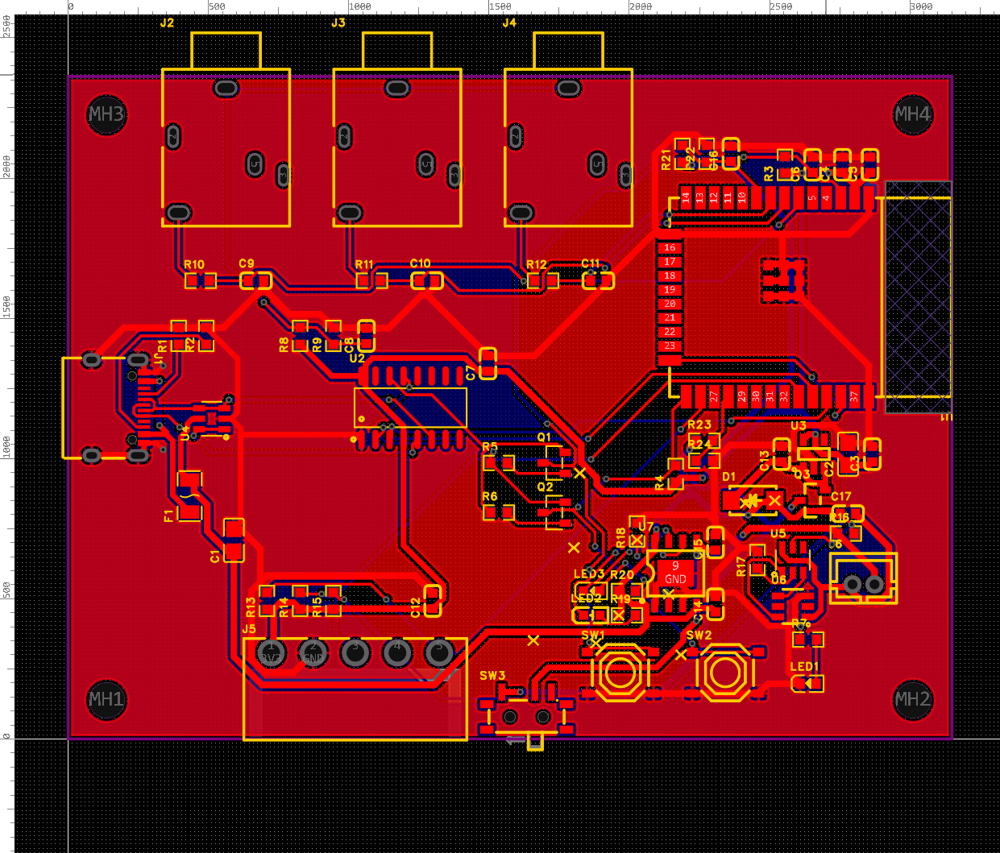
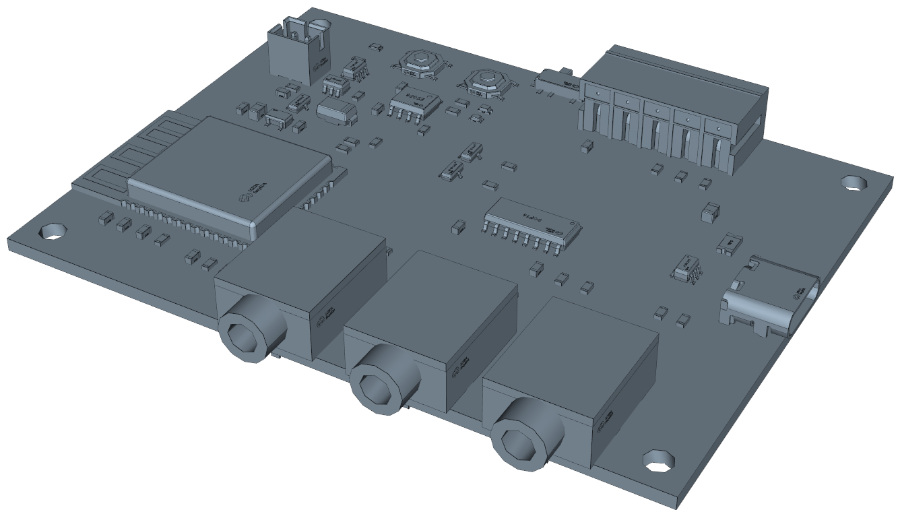

# PCB do coletor — v0.2 (proposta)

> **Apenas proposta.** Esta placa é apresentada no TCC como *próximo passo* do protótipo. Ela **não será
> fabricada nem comprada**: o projeto segue com o protótipo atual (ESP32 DevKit + protoboard + shield),
> descrito no [README principal](../README.md). Os arquivos de fabricação ficam aqui só para mostrar que a
> proposta está completa e pronta caso o projeto avance no futuro.

A proposta troca a protoboard com o DevKit por uma placa própria com o **ESP32-WROOM-32E soldado**,
alimentada pela USB-C **ou por uma bateria Li-ion** que carrega quando a USB está plugada. Os sensores usam
**os mesmos GPIOs** do protótipo, então o firmware 1.1.0 rodaria nela sem alteração; a leitura da bateria e
da USB dependeria de atualização do firmware.

| Arquivo / pasta | Conteúdo |
|---|---|
| [`desenho_interface_v0.2.pdf`](desenho_interface_v0.2.pdf) | **Desenho técnico para a caixa** (A3, 2 folhas): vista de cima e das 4 bordas com cotas, sobra de cada conector além da borda, alturas, furos e tabela de aberturas |
| `easyeda/Coletor-Eixo.eprj2` | Projeto do EasyEDA Pro 3.2 (esquemático A2 + PCB). Abrir em *File → Open Project* |
| `fabricacao/` | Gerber (zip), BOM e Pick & Place no formato da JLCPCB, gerados para completar a proposta (não há pedido previsto). O modelo 3D (STEP, 33 MB) não vai para o repositório: exporte pelo EasyEDA em *Export → 3D File* |
| `scripts/` | Utilitários de acesso à API do EasyEDA ([easyeda-api-skill](https://github.com/easyeda/easyeda-api-skill)) e o script que gerou o esquemático da v0.1 |

## Placa

- **80,0 × 60,0 mm, FR-4 1,6 mm, 2 camadas**, regras "JLCPCB Capability (Two Layers Board)", 4 furos Ø3,2 (M3)
  a 3,5 mm das bordas.
- **Frente (y = 60):** 3 jacks P2 (PJ-3240-5A) para os SCT-013. O corpo sai 0,7 mm e o bico 4,15 mm além da borda.
- **Trás (y = 0):** borneira plugável de 5 vias 3,81 mm para a unidade de sensores (rente à borda) e chave
  liga/desliga da bateria (alavanca 0,8 mm para fora).
- **Esquerda (x = 0):** USB-C (alimentação, carga e gravação), 0,49 mm para fora.
- **Direita (x = 80):** antena do ESP32 rente à borda, com área sem cobre e sem trilha embaixo.
- **Em cima:** botões RESET e BOOT, LED de status (azul) e LEDs de carga (vermelho/verde), conector da bateria.
- Plano de GND nas duas faces; trilhas de alimentação (VBUS, +5V, VSYS, 3V3, bateria, GND) com 0,5–0,6 mm.

Todas as medidas para a caixa estão no [desenho técnico](desenho_interface_v0.2.pdf).

## Circuito

| Bloco | Peças | Ligação |
|---|---|---|
| Entrada USB-C | J1, R1/R2 5,1k nos CC, F1 PTC 500 mA, U4 USBLC6 (ESD) | o carregador entrega 5 V com os 5,1k |
| Bateria | J6 JST-PH 2 vias, U5 DW01A + U6 FS8205A (proteção), SW3 liga/desliga | 1 célula Li-ion 3,7 V |
| Carga | U7 TP4056 a 500 mA (R18 2,4k), LED2 vermelho = carregando, LED3 verde = carregada | alimentado pela USB-C |
| Troca USB/bateria | D1 SS14 (+5V → VSYS), Q3 AO3401A (bateria → VSYS quando a USB sai) | sem reiniciar na troca |
| 3,3 V | U3 AP2112K-3.3 (600 mA, queda 0,25 V), C13 10 µF, C2 22 µF, C3 100 nF | funciona a partir de 3,5 V |
| ESP32 | U1 ESP32-WROOM-32E-N4 (4 MB), C4 10 µF + C5 100 nF, R3 10k + C6 1 µF no EN | — |
| Gravação | U2 CH340C, Q1/Q2 MMBT3904 + R5/R6 (auto-reset DTR/RTS) | grava sem apertar BOOT |
| Botões e LED | SW1 RESET (EN), SW2 BOOT (GPIO0) + R4 10k, LED1 azul + R7 1k | GPIO0, GPIO2 |
| Corrente | J2–J4 (P2), polarização 1,65 V (R8/R9 10k + C8 10 µF), filtro 1k + 10 nF por fase | GPIO34, 35, 32 |
| Unidade de sensores | J5: 3V3, GND, SDA, SCL, 1-Wire; pull-ups 4,7k (R13–R15), C12 100 nF | GPIO21/22 (I2C), GPIO4 (DS18B20) |
| Leituras novas | R21/R22 100k (bateria ÷ 2), R23 68k / R24 100k (USB presente, 2,98 V) | **GPIO33** (ADC), **GPIO17** (digital) |

São 65 componentes, 33 itens na BOM, todos com código LCSC.

### Bateria

Recomendação: **uma célula 18650 de 3000–3500 mAh** em suporte com fio, ligada ao J6. Uma LiPo achatada
(ex.: 103450, 2000 mAh) também serve no mesmo conector. Com o firmware atual (Wi-Fi sempre ligado,
~100 mA), uma 18650 dura **cerca de 1 dia**; para semanas, é preciso um modo bateria no firmware (coleta a
cada poucos minutos e sono profundo entre elas).

- **Polaridade do J6:** pino 1 = +, pino 2 = −. Não há padrão entre cabos JST de bateria: confira antes de ligar.
- A proteção da placa (DW01A + FS8205A) cobre sobrecarga, descarga profunda e curto, então serve célula sem
  proteção própria.
- A SW3 desliga só a bateria; com a USB plugada a placa funciona e carrega com a chave em qualquer posição.
- Não carregar acima de ~45 °C: a unidade principal não deve ficar encostada na carcaça quente do motor.
- O CH340C continua alimentado pelo 3V3 e consome alguns mA mesmo na bateria.

## Conferido

- Netlist da PCB comparada pad a pad com o circuito acima: todas as 43 redes batem.
- DRC da PCB sem erros (folgas, conexões, área da antena); 43/43 redes roteadas.
- Esquemático em A2 ligado por fios, em blocos, com cores por tipo de rede, carimbo do Eixo e quadro de notas.
  Conectividade conferida pino a pino; nenhum fio sobre corpo de peça e nenhum par de fios de redes
  diferentes correndo colado.
- Contorno fechado: no 3D a placa tem exatamente 80,0 × 60,0 mm (na v0.1 o contorno estava aberto e o 3D
  mostrava uma placa maior).

## Pendências (só se a proposta for fabricada um dia)

Nada disto bloqueia o protótipo atual; são os pontos que teriam de ser conferidos antes de um pedido.

- **Pinagem do jack P2:** pino 1 = manga (polarização), pino 4 = ponta (sinal), deduzidos pela cota do
  datasheet. Medir com multímetro num PJ-3240-5A com o plugue do SCT-013.
- **Botão TS-1187A:** assumido o padrão 1–2 e 3–4 interligados.
- **Polaridade do cabo da bateria** (ver acima).
- Na PCB, as redes de sinal têm nomes automáticos (`$1N…`) em vez de EN, SDA etc.: a ligação está certa, só
  o nome não veio do esquemático.
- **Firmware:** ler a tensão da bateria (GPIO33, ADC, divisor ÷ 2) e a presença da USB (GPIO17).
- **Caixa:** a atual é para a protoboard de 83 × 55 mm; uma caixa para esta placa sairia do
  [desenho técnico](desenho_interface_v0.2.pdf).

## Evoluções possíveis apresentadas junto com a proposta

1. **Placa da unidade de sensores** com o ADXL345 soldado direto; por SPI ele chega à banda até 1000 Hz da
   ISO 10816 (ver README do firmware).
2. **Modo bateria** no firmware (coleta espaçada e sono profundo) para a autonomia passar de 1 dia para semanas.
