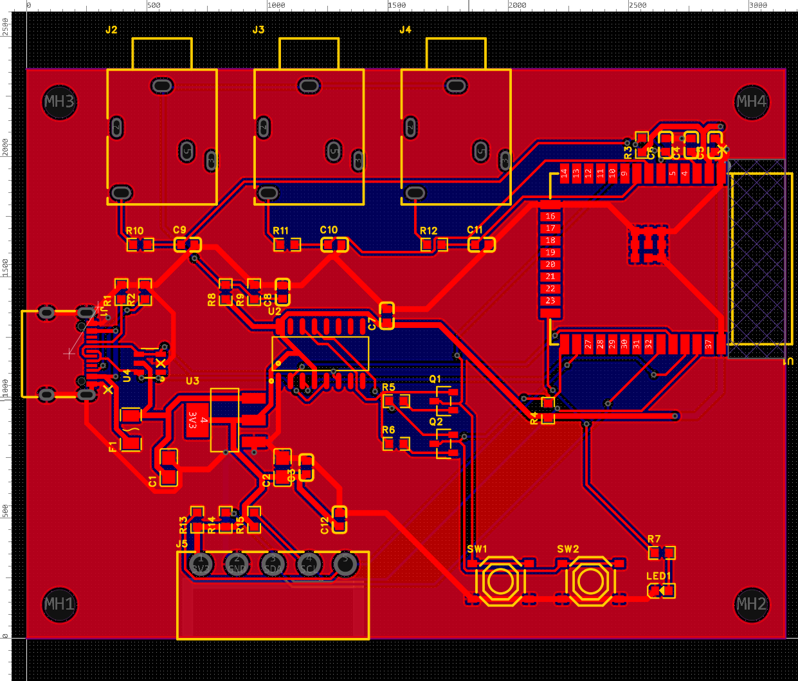

# PCB do coletor — v0.1 (proposta, não fabricada)

Próximo passo do protótipo: trocar a protoboard com o DevKit por uma placa própria com o
**ESP32-WROOM-32E soldado**. O circuito é o mesmo do protótipo e **usa os mesmos GPIOs**, então o
firmware 1.1.0 roda sem alteração.

| Pasta | Conteúdo |
|---|---|
| `easyeda/Coletor-Eixo.eprj2` | Projeto do EasyEDA Pro 3.2 (esquemático + PCB). Abrir em *File → Open Project* |
| `fabricacao/` | Gerber (zip), BOM e Pick & Place no formato da JLCPCB. O modelo 3D (STEP, 22 MB) não vai para o repositório: exporte pelo EasyEDA em *Export → 3D File* |
| `scripts/` | Script que gerou o esquemático pela API do EasyEDA ([easyeda-api-skill](https://github.com/easyeda/easyeda-api-skill)) |

## Placa

- **80 × 60 mm, 2 camadas**, regras "JLCPCB Capability (Two Layers Board)", 4 furos M3 nos cantos.
- **Frente (borda de cima na imagem):** 3 jacks P2 (PJ-3240-5A) para os SCT-013, com o bico para fora,
  no lugar dos adaptadores P2 → borne da caixa atual.
- **Trás:** borneira plugável de 5 vias 3,81 mm para a unidade de sensores, botões **RESET** e **BOOT**,
  LED de status.
- **Lateral esquerda:** USB-C (alimentação e gravação).
- **Borda direita:** antena do ESP32, com área sem cobre e sem trilha embaixo.
- Plano de GND nas duas faces; trilhas de alimentação (VBUS, +5V, 3V3, GND) com 0,5–0,6 mm.

## Circuito

| Bloco | Peças | Ligação |
|---|---|---|
| Entrada USB-C | J1, R1/R2 5,1k nos CC, F1 PTC 500 mA, U4 USBLC6 (ESD) | o carregador entrega 5 V com os 5,1k |
| 3,3 V | U3 AMS1117-3.3, C1/C2 22 µF, C3 100 nF | — |
| ESP32 | U1 ESP32-WROOM-32E-N4 (4 MB), C4 10 µF + C5 100 nF no 3V3, R3 10k + C6 1 µF no EN | — |
| Gravação | U2 CH340C, Q1/Q2 MMBT3904 + R5/R6 (auto-reset DTR/RTS) | grava sem apertar BOOT |
| Botões e LED | SW1 RESET (EN), SW2 BOOT (GPIO0) + R4 10k, LED1 azul + R7 1k | GPIO0, GPIO2 |
| Corrente | J2–J4 (P2), polarização 1,65 V (R8/R9 10k + C8 10 µF), filtro 1k + 10 nF por fase | GPIO34, 35, 32 |
| Unidade de sensores | J5: 3V3, GND, SDA, SCL, 1-Wire; pull-ups 4,7k (R13–R15), C12 100 nF | GPIO21/22 (I2C), GPIO4 (DS18B20) |

São 42 componentes, 20 itens na BOM, todos com código LCSC (a maioria *Basic Part* da JLCPCB).

## Conferido

- Netlist da PCB comparada pino a pino com o circuito acima: todas as 28 redes batem.
- Esquemático em A3 ligado por fios, em blocos, com cores por tipo de rede (alimentação vermelho, GND preto,
  USB azul, analógico dos SCT laranja, demais sinais verde) e carimbo do Eixo; conectividade conferida
  pino a pino contra a mesma netlist da PCB.
- DRC da PCB sem erros (folgas, conexões, área da antena).
- DRC do esquemático: 0 erros, 2 avisos (não detalhados pela API; ver no EasyEDA em *Design → Check DRC*).

## A confirmar antes de fabricar

- **Pinagem do jack P2:** pino 1 = manga (ligado na polarização), pino 4 = ponta (sinal), deduzidos pela
  cota do datasheet. Medir com multímetro num PJ-3240-5A com o plugue do SCT-013.
- **Botão TS-1187A:** assumido o padrão 1–2 e 3–4 interligados. Conferir no datasheet ou com multímetro.
- **Caixa:** a unidade principal precisa de nova tampa/frente (jacks direto na placa, USB-C na lateral
  esquerda, borneira atrás) — o modelo atual é para a protoboard de 83 × 55 mm.
- Revisão visual do roteamento automático, principalmente em volta do CH340C e do USB-C.

## Próximos passos sugeridos

1. **Placa da unidade de sensores** com o ADXL345 soldado direto (hoje o GY-291 vai numa perfurada).
   Ligar o ADXL345 por SPI permitiria a banda até 1000 Hz da ISO 10816 (ver README do firmware).
2. Orçamento na JLCPCB: enviar `fabricacao/Gerber_*.zip`; para montagem SMT, `BOM_*.csv` e
   `PickAndPlace_*.csv`. Os jacks P2 e a borneira (PTH) podem ser soldados à mão.
